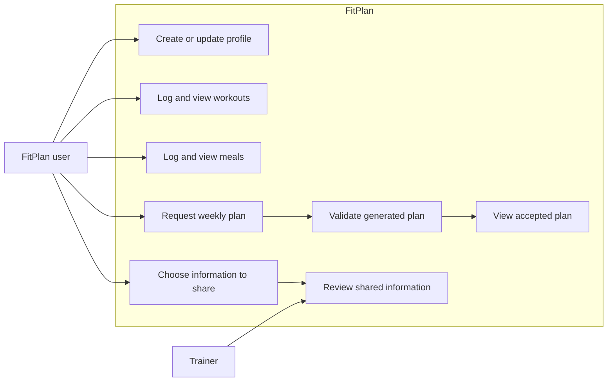
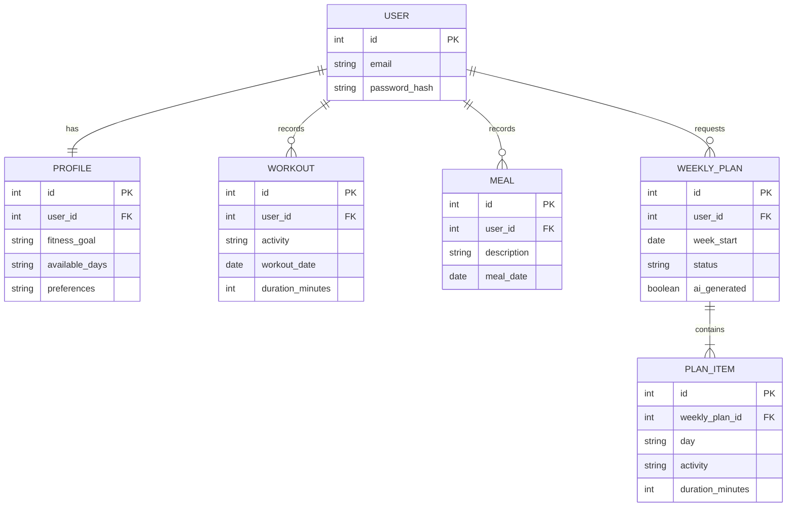

# FitPlan Design Diagrams

## Use-case view

The user manages their profile and personal logs and requests a weekly plan. The trainer can review only information the user chooses to share. The application validates a generated plan before displaying it.

## Data model

This is a first draft of the data model. Review the fields with your team and instructor before implementation. Do not store real health information in test data.
